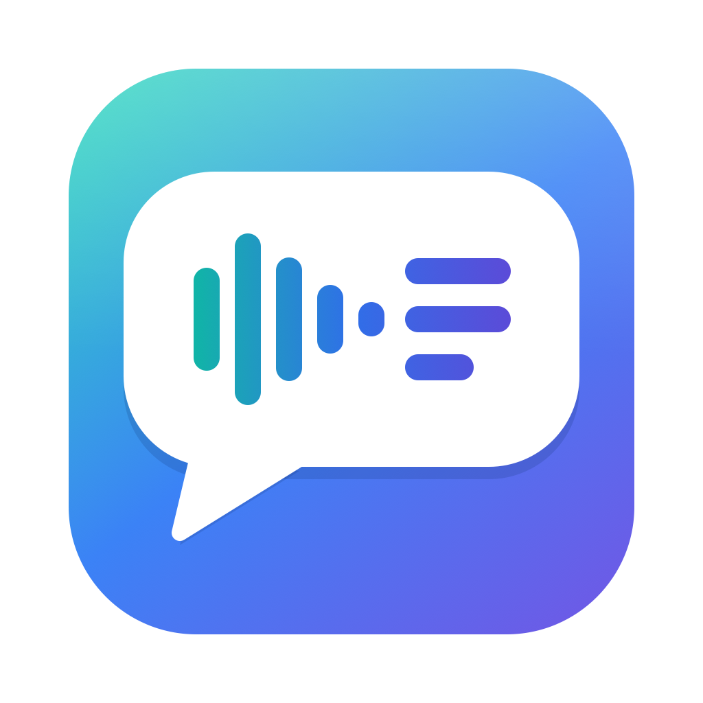

<p align="center">
  
</p>

<h1 align="center">Wordwave</h1>

<p align="center"><b>Voice notes, as words.</b><br>
A macOS menu bar app that transcribes the WhatsApp voice notes you receive, on your Mac.</p>

---

## What it does

- A waveform icon in the menu bar shows how many voice notes you haven't read yet.
- Each voice note is transcribed on-device. Voice notes that arrive while Wordwave is running also get a system notification with the transcript.
- The panel lists unread voice notes on top, each with sender, profile picture, transcript and arrival time.
- Clicking a card opens the chat in WhatsApp and marks the note as seen. Seen notes move to a collapsed "Seen" section.
- English UI, with Italian translation. The transcription language follows the system language, or can be picked from the menu.

## How it works

Wordwave reads the local database of **WhatsApp Desktop for Mac** (the Mac App Store app), read-only:

- new voice notes come from `ChatStorage.sqlite` in WhatsApp's group container, polled every 3 seconds;
- the `.opus` audio WhatsApp already downloaded is transcribed with Apple's `SpeechAnalyzer` / `SpeechTranscriber` (macOS 26);
- names and profile pictures come from WhatsApp's local contacts store and profile picture cache.

It opens WhatsApp's database read-only, never modifies WhatsApp's data and never talks to WhatsApp's servers.

## Privacy

- Transcription runs entirely on your Mac. Wordwave itself makes no network requests and sends your data nowhere; the first time, macOS may download Apple's speech model for your language.
- Wordwave keeps its own list (transcripts and seen state) in `~/Library/Application Support/Wordwave/state.json`. Seen notes are pruned after 7 days.

## Requirements

- macOS 26 or later, Apple silicon
- WhatsApp Desktop for Mac, signed in, with voice notes set to download automatically
- Xcode 26 and [XcodeGen](https://github.com/yonaskolb/XcodeGen) to build

## Build and run

```bash
brew install xcodegen
scripts/run.sh            # Release build, installed to ~/Applications and launched
scripts/run.sh --debug    # Debug build, with the panel also shown in a regular window
```

Builds are signed ad-hoc by default. Ad-hoc builds can lose macOS permissions after a rebuild; to sign with your own certificate, copy `Config/Local.xcconfig.example` to `Config/Local.xcconfig` and set your team ID.

On first launch macOS may ask to let Wordwave access data from other apps: choose **Allow**. If it doesn't ask and the panel says access is blocked, add Wordwave under System Settings → Privacy & Security → Full Disk Access.

Launching from an Applications folder turns on **Launch at Login** once; the toggle in the ⋯ menu turns it off.

## Limitations

- WhatsApp has no public link to a single message, so a click opens the chat, not the exact voice note.
- Group chats, and senders whose phone number isn't in WhatsApp's local data, just bring WhatsApp to the front.
- WhatsApp Web in a browser is not supported.
- WhatsApp's local database is undocumented and can change with any WhatsApp update.

## Disclaimer

Wordwave is an independent project. It is not affiliated with, endorsed by, or sponsored by WhatsApp or Meta. WhatsApp is a trademark of its respective owner.

## License

Copyright © 2026 Stefano Squillante. All rights reserved except as granted by the license.

Wordwave is source-available under the [PolyForm Noncommercial License 1.0.0](LICENSE.md): free for personal and other noncommercial use. Commercial use of any kind requires a separate license from the author.
